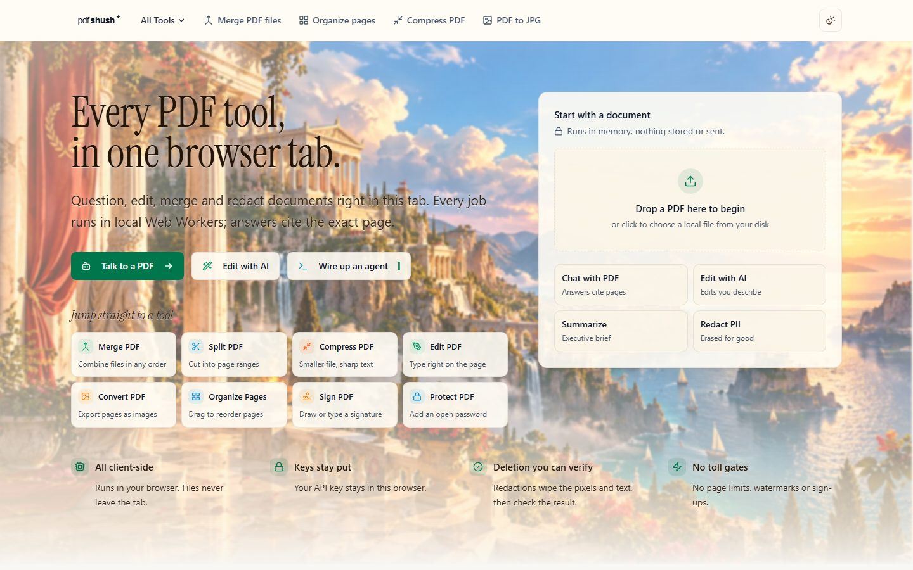
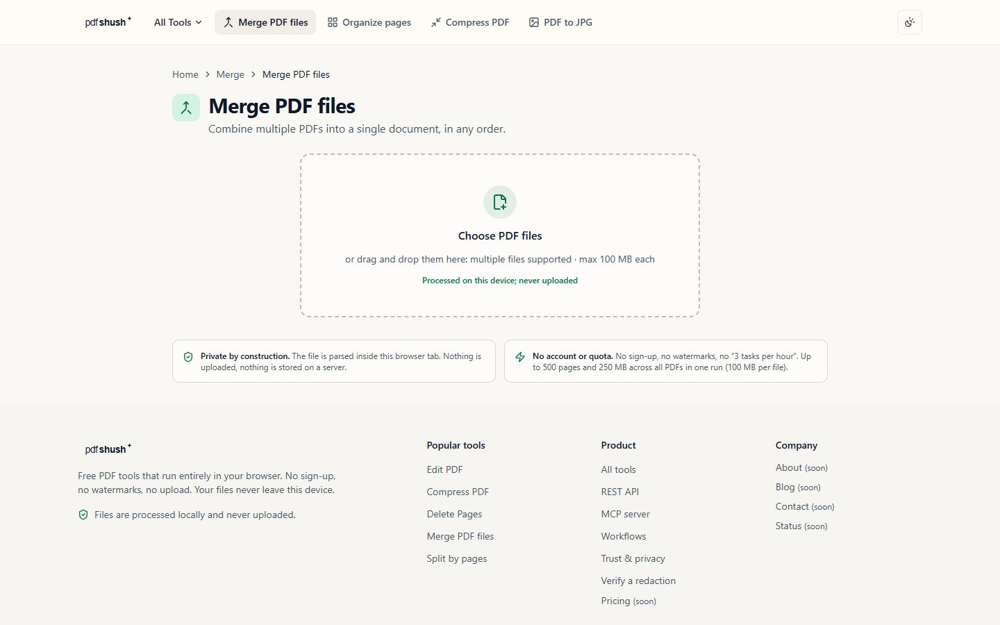

<p align="center">
  <picture>
    <source media="(prefers-color-scheme: dark)" srcset="docs/assets/pdfshush-wordmark-dark-640.png">
    
  </picture>
</p>

<p align="center"><strong>Free PDF tools that never upload your files.</strong></p>

<p align="center">
  <a href="https://pdfshush.7468dhruv.workers.dev"></a>
</p>

<p align="center">
  <a href="https://pdfshush.7468dhruv.workers.dev">Live app</a>
  &nbsp;·&nbsp; <a href="#tools">Tools</a>
  &nbsp;·&nbsp; <a href="#private-by-default">Privacy</a>
  &nbsp;·&nbsp; <a href="#run-it-yourself">Self-host</a>
</p>

<p align="center">
  
  
  
</p>



**PDFShush is a free PDF toolkit that runs entirely in your browser.** Merge, split, sign, redact, OCR, compress: pick a tool, drop a file, download the result. Your document never leaves your device.

No account. No upload. No waiting for a server.

<p align="center">
  <a href="https://pdfshush.7468dhruv.workers.dev/tools/merge-pdf">Merge PDF</a> ·
  <a href="https://pdfshush.7468dhruv.workers.dev/tools/compress-pdf">Compress PDF</a> ·
  <a href="https://pdfshush.7468dhruv.workers.dev/tools/redact-pdf">Redact PDF</a> ·
  <a href="https://pdfshush.7468dhruv.workers.dev/tools/fill-sign">Sign a PDF</a> ·
  <a href="https://pdfshush.7468dhruv.workers.dev/tools/ocr-pdf">OCR a scan</a>
</p>

## A real look

| The app | A tool |
| --- | --- |
|  |  |

## Tools

**Merge & organize:** Merge PDF, Organize pages, Alternate & mix, Combine files, Delete pages, Extract pages, Rotate, N-up, Crop, Batch run.

**Split:** Split by pages, Split in half, Split by size, Split by text, Split by bookmarks.

**Edit & sign:** Edit PDF, Fill & sign, Signature, Create forms, Create bookmarks, Page numbers, Header & footer, Watermark, Stamp, Bates numbering, Edit metadata, Rename, Image editor.

**Convert & clean:** PDF to JPG, PDF to text, Extract images, JPG to PDF, Compress, Grayscale, Dark mode, Resize, Flip, Deskew, OCR, Repair, Flatten, Remove annotations.

**Protect:** Redact PDF (with a verifier), Protect with a password, Unlock.

**AI, with your own key:** Summarize, Chat with a PDF, Edit with AI.

<p align="center">
  <a href="https://pdfshush.7468dhruv.workers.dev"><strong>See all 48 tools →</strong></a>
</p>

## Private by default

| Your files stay here | Your keys stay here | Your work still works |
| --- | --- | --- |
| Every tool runs inside your browser tab. There is no upload endpoint, no file server, and no copy of your document on our side. | AI tools use your own provider key. It is stored in your browser and sent straight to the provider you chose. | Install PDFShush as an app and keep using tools offline. Once a tool is open, the network is optional. |

Redaction is the one you can check: pages are rebuilt without the hidden text or images, then reopened and verified before the download appears. The [verifier](https://pdfshush.7468dhruv.workers.dev/verify) lets you inspect the result yourself.

When you use an AI tool, the text you choose to send goes to your AI provider, not to us. Everything else stays on your device.

## Drop, pick, done

1. **Drop a PDF.** Choose a local file, or drag it into the tab.
2. **Pick a tool.** Merge, sign, redact, OCR, compress. It opens in place.
3. **Download the result.** The finished file is built in your browser.

Nothing is sent anywhere in between.

## Run it yourself

PDFShush is open source. The frontend runs on its own. No Docker, no database, no API keys.

```bash
pnpm install
pnpm dev            # http://localhost:5173
```

Production build and deploy:

```bash
pnpm build
npx wrangler deploy
```

Requires Node 20.19+ and pnpm 12. The production build is frontend-only by default. The optional server tier (account sync, workflow recipes, REST API, MCP) is documented in [`docs/DEPLOY.md`](./docs/DEPLOY.md); the Cloudflare Workers runbook is [`docs/DEPLOY-WORKERS.md`](./docs/DEPLOY-WORKERS.md).

## License

[AGPL-3.0-or-later](./LICENSE). The UI foundation is the MIT-licensed [shadcn dashboard & landing template](https://github.com/shadcnstore/shadcn-dashboard-landing-template); its notice is in [`licenses/`](./licenses/). The PDF engine builds on [pdf-lib](https://github.com/cantoo-pdf-lib/pdf-lib), [pdf.js](https://mozilla.github.io/pdf.js/), [PDFium](https://github.com/embedpdf/embed-pdf-viewer), [Tesseract.js](https://github.com/naptha/tesseract.js) and [fflate](https://github.com/101arrowz/fflate). Product scope is modeled on [Sejda](https://www.sejda.com/) (not affiliated).

<p align="center"><sub>Made for documents that are nobody else's business.</sub></p>
